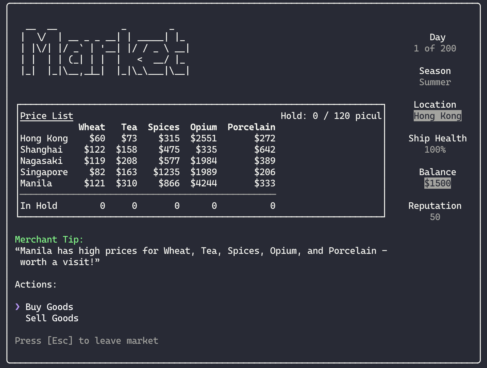

<pre style="color:green;background:transparent">
███████ ███████  █████      ████████ ██████   █████  ██████  ███████ ██████  
██      ██      ██   ██        ██    ██   ██ ██   ██ ██   ██ ██      ██   ██ 
███████ █████   ███████        ██    ██████  ███████ ██   ██ █████   ██████  
     ██ ██      ██   ██        ██    ██   ██ ██   ██ ██   ██ ██      ██   ██ 
███████ ███████ ██   ██        ██    ██   ██ ██   ██ ██████  ███████ ██   ██ 
</pre>

<br />



<br />

[](https://github.com/zyishai/sea-trader/releases)

[](https://github.com/zyishai/sea-trader/blob/main/LICENSE)

# 🚢 Overview

_Sea Trader_ is a terminal-based trading simulation set in 19th century East Asia. As a maritime merchant, you'll navigate the South China Sea during a 200-day voyage. Trade exotic goods between bustling ports, fight off pirates, and master the ever-changing markets to maximize your wealth!

# ⚡️ Quick Start

Run the game directly with:

```bash
$ npx ctrader
```

## Requirements

- **Node.js** 18 or newer.
- **Terminal**: any modern terminal with Unicode and color support, on macOS, Linux, or Windows. On Windows, use Windows Terminal.
- **Window size**: at least 60×20 characters. At 80×32 or larger, every game screen fits without scrolling.

If a screen doesn't fit, scroll with the mouse wheel or PgUp/PgDn (Fn+↑/↓ on Mac laptops). While a screen can scroll, hold Shift (Option on macOS) to select text with the mouse. If the window is below the minimum size, enlarge it or zoom out.

# 🧭 How to Play

You start in Hong Kong with a small junk and $1500. Over 200 days, buy goods where they're cheap and sell them where they're dear, then retire with the highest score you can.

- **Market**: prices differ by port, change every 14 days, and swing with the seasons. Merchant tips point out bargains.
- **Port**: set sail for another port. Passages take days and may bring storms, pirates or an uncharted island.
- **Shipyard**: repair damage, upgrade speed, defense and hold capacity, and hire guard ships.
- **Score**: your net worth plus a bonus for a bigger, faster ship, minus damage. Reach 5,000 to rank Captain and 30,000 for Admiral.

Press **H** on the start screen for the full in-game guide.

# 🎮 Core Features

- Trade between 5 ports: Hong Kong, Shanghai, Nagasaki, Singapore, and Manila
- Deal in period goods: Wheat, Tea, Spices, Opium, and Porcelain, counted in picul
- Read the market with price history, seasonal swings, and merchant tips
- Upgrade your ship's speed, defense, and hold capacity
- Protect your cargo with hired guard ships, and fight, flee, or bribe pirates
- Weather storms and face events that ask you to choose, from typhoons to hidden treasure
- Play the classic 200-day voyage, or an extended one with no end date

# 💡 Game Strategy Tips

- Ports sell what they produce below the usual price, and trading hubs and large markets are cheaper overall.
- Seasons change every 30 days, moving some prices up and others down. Buy before a seasonal high.
- You can only buy with money you have. Debt from fees costs 3% a day, and below -$4000 you go bankrupt.
- You can overload the hold by 20%, but an overloaded ship sails slower and struggles to escape pirates.
- Reputation earns better merchant tips and fewer pirate attacks. Win fights and upgrade your ship to raise it.
- Keep your ship repaired: below 40% condition it can't sail, and damage lowers your final score.
- Guard ships absorb most combat damage but cost a daily upkeep, and fight at half strength while you're in debt.

# 🤝 Contribution

The game's core mechanics are under active development, but we welcome:

- Feature suggestions
- Game balance feedback
- Bug reports
- Historical accuracy improvements

# 🛠️ Development

```bash
npm install
npm run dev   # build and play locally
npm run ci    # format check, lint, type-check, build and tests
```

The game lives in `src/game`: a standalone core that runs without any UI. Shells drive it with commands and listen through plugins (`createGame`, `connectPlugin`), importing only `src/game/index.ts`. The terminal shell lives in `src/terminal`. Domain terms are defined in [CONTEXT.md](CONTEXT.md).

# 📜 License

MIT - This is an Open Source game! 💪
